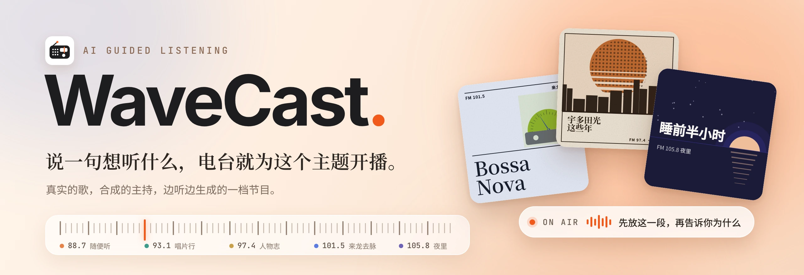
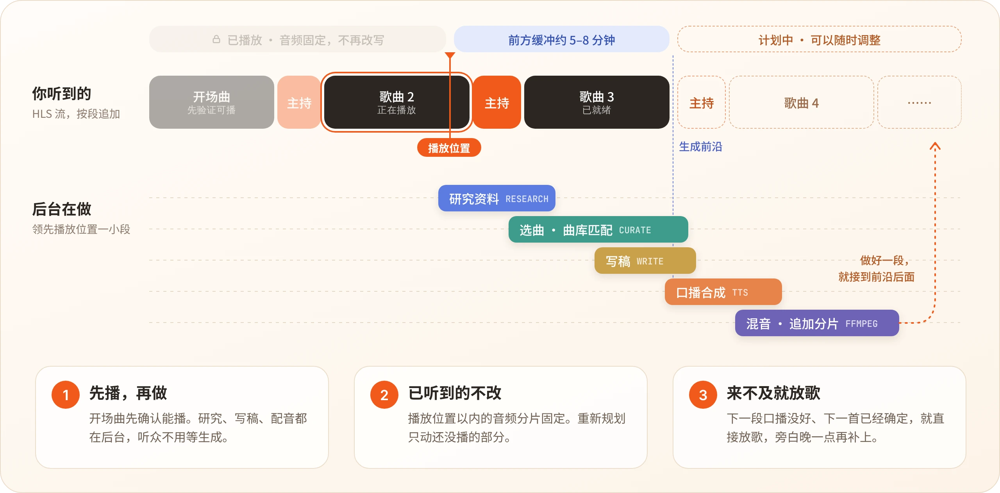
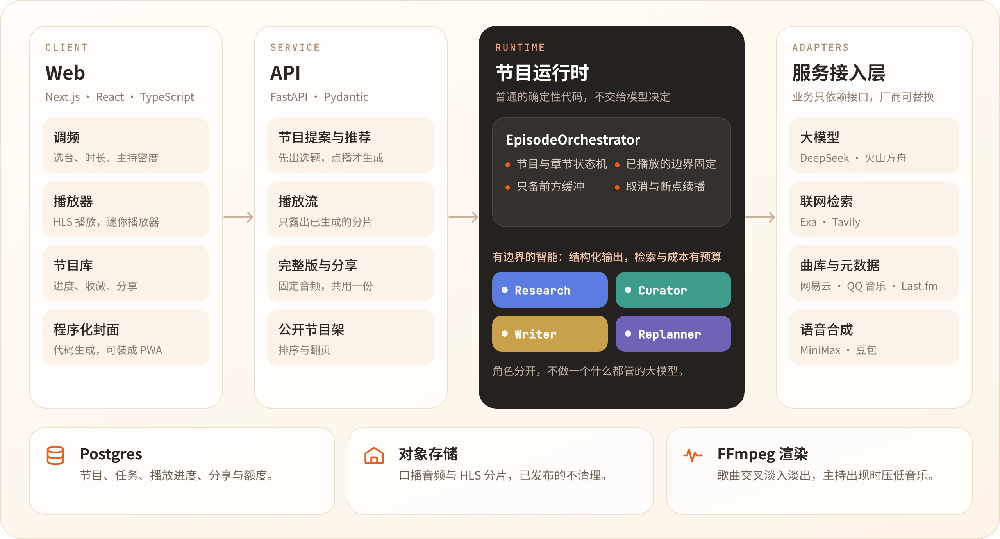

<p align="center">
  
</p>

<h1 align="center">WaveCast</h1>

<p align="center"><b>说一句想听什么，电台就为这个主题开播。</b></p>

<p align="center">
  <a href="https://wavecast.space"></a>
  
  
  
  
  
  <a href="LICENSE"></a>
</p>

WaveCast 把一个音乐问题变成一档可收听的节目。比如输入「City Pop 是怎么来的？」或「从一首喜欢的歌出发，挖几首没听过的」，它会查资料、选曲、编排节目，并用合成主持串起歌曲与故事。开场先播，后面的章节边听边准备。

*WaveCast is an on-demand guided-listening radio app. It turns a music prompt into a hosted programme, starts with a playable opening, and prepares later chapters while you listen.*

<p align="center"><a href="#参赛海报">参赛海报</a> · <a href="#功能">功能</a> · <a href="#边播边生成">边播边生成</a> · <a href="#架构">架构</a> · <a href="#工程上做了什么">工程亮点</a> · <a href="#本地体验">本地体验</a> · <a href="#开发索引">开发索引</a></p>

> 这是一个已结束开发阶段的音乐 AI Hackathon 项目。仓库保留实现和设计记录，暂无后续开发计划。在线版 [wavecast.space](https://wavecast.space) 仍可体验，推荐用 iPhone Safari 打开。

## 参赛海报

<p align="center">
  <a href="docs/assets/wavecast-poster-v7.png">
    
  </a>
</p>
<p align="center"><sub>腾讯音乐高校 AI Hackathon 参赛海报。界面、封面与节目内容均为设计示意。点击图片查看原图。</sub></p>

## 一档节目怎么开始

1. **选台、写主题。** 像调收音机一样切换电台，选择时长和主持密度，再输入想听的方向。
2. **先拿到节目提案。** 提案有标题、简介和经曲库匹配的开场曲。首页推荐也先展示选题，点播才为它准备节目。
3. **听着开场，等后面的内容接上。** 播放器提供节目路线、主持词和跳转。也可以主动准备完整版，再创建分享链接。

## 功能

| 在产品里 | 可以做什么 |
| --- | --- |
| **五种电台** | 88.7 随便听、93.1 唱片行、97.4 人物志、101.5 来龙去脉、105.8 夜里。可选只听歌、轻口播或更多讲解。 |
| **研究和选曲** | 围绕主题检索背景，把资料交给选曲和写稿阶段。候选歌曲经过曲库匹配，研究资料沿用到后续章节。 |
| **电台式混音** | 处理歌曲交叉淡入淡出、主持声出现时的音乐压低，以及有时序资料时的口播落点。支持单人主持，部分节目路径可用双人对话。 |
| **持续收听** | HLS 流按段扩展。迷你播放器支持跨页面收听，节目库记录进度、收藏和已生成节目。 |
| **完整节目与分享** | 后台准备完整版，将固定音频发布为链接。听众共享同一份音频，各自保留收听进度。选择公开的节目可以进入「大家都在听」。 |
| **发现与封面** | 游客可以选播精选主题，登录用户可以获取个性化推荐。节目封面由代码生成，移动端支持安装为 PWA。 |

## 边播边生成

<p align="center">
  
</p>

- **把等待放到收听过程中。** 开场先验证曲目可播。更深入的检索、编排、写稿和配音分段进行，优先准备下一段需要的内容。
- **控制未收听内容的生成成本。** 推荐卡片先生成选题，节目由用户操作触发。默认只维持前方的播放缓冲，完整版由用户主动请求。检索和模型调用设有上限。如果可选口播来不及，运行时可以继续播放已准备好的音乐。
- **守住已经听到的内容。** 播放位置、任务状态和发布边界由确定性代码管理。后续编排可以继续变化，已经对听众开放的音频分片保持固定。分享会在完整音频通过校验后才生成可用链接。

[播放运行时](docs/adr/0020-buffered-streaming-runtime-v2.md) · [研究与开场](docs/adr/0039-researched-openings-and-proposal-recovery.md) · [发布音频](docs/adr/0037-published-programmes.md)

## 架构

<p align="center">
  
</p>

节目运行时是普通的确定性代码：节目和章节的状态、哪些内容已经对听众开放、缓冲留多少、任务取消与续播，都由它决定。模型只在它划定的边界里工作，分成研究、选曲、写稿、重新规划四个角色，输出结构化结果，检索次数和成本有预算。业务代码只依赖接口，大模型、检索、曲库和语音都通过适配器接入，可以替换，也都有用于测试的模拟实现。

## 工程上做了什么

- **把等待藏在播放里。** 先开播再生成，并区分「已播放」「已就绪」「计划中」三段内容。后台生成只比播放位置领先一小段，不为没人听的内容花钱。
- **音频一旦放出就不再改。** 分片在播放边界内固定，后续规划只改没播的部分。后来补写的旁白如果会改动已经固定的音频，就跳过它。分享和完整版也遵守同样的规则，相关不变量都有回归测试。
- **不依赖任何一个厂商。** 大模型、检索、曲库、语音都在接口后面。没有密钥时用模拟实现，测试默认不调用付费接口，本地用 Docker Compose 就能完整体验。
- **控制成本。** 推荐只生成选题，点播才生成节目。检索、模型调用、每日额度和同时准备的数量都有上限，用量有记录。
- **能放心改的代码。** 后端约 1900 个测试，前端约 490 个。CI 按改动范围选择检查，发版前走完整验证。40 篇架构决策记录（ADR）写明每个关键取舍，包括后来被取代的方案。
- **从产品到上线都自己做完。** 调频与播放界面、程序化封面、PWA、登录与额度、分享、后台任务、部署（Vercel、Railway、Postgres）。

## 本地体验

用 Docker Compose 启动 Web、API 和 Postgres。默认使用模拟歌曲、主持和模型服务，无需 API 密钥。

```bash
git clone https://github.com/ZakuZakuu/wavecast.git
cd wavecast
docker compose -f docker-compose.prod.yml up --build
```

打开 [localhost:3000](http://localhost:3000)，到「调频」输入主题并开播。真实曲库、搜索和语音服务可以按需配置，配置入口见 [.env.example](.env.example)。

<details>
<summary>源码开发与验证</summary>

需要 Python 3.12+、[uv](https://docs.astral.sh/uv/)、Node.js 24、pnpm 10，以及可执行的 FFmpeg 和 FFprobe。

```bash
uv sync --all-groups
pnpm install --frozen-lockfile
```

分别在两个终端启动 API 和 Web：

```bash
uv run uvicorn services.api.main:app --reload --port 8000
```

```bash
pnpm dev:web
```

```bash
uv run ruff check .
uv run mypy
uv run pytest
pnpm lint
pnpm typecheck
pnpm test:web
pnpm build
```

默认开发使用内存存储。需要测试持久化时，可用上面的 Compose 配置。Postgres 集成测试与部署验证见 [CI 文档](docs/deployment/ci.md)。

</details>

## 开发索引

| 位置 | 内容 |
| --- | --- |
| [apps/web](apps/web) | Next.js、React、TypeScript。调频、播放器、节目库和程序化封面。 |
| [services/api](services/api) | FastAPI。节目提案、播放、生成任务和分享 API。 |
| [backend/wavecast](backend/wavecast) | 研究与编排、任务生命周期、FFmpeg/HLS 渲染和 Postgres 持久化。 |
| [设计与决策](docs/adr) | 关键架构决策，以及 [Frost 界面设计源文件](docs/design/frost)。 |

## 许可证

项目代码使用 [MIT License](LICENSE)。第三方材料见 [第三方说明](docs/third-party/README.md)。曲库录音、专辑封面以及外部服务的使用遵循各自的授权与服务条款。
